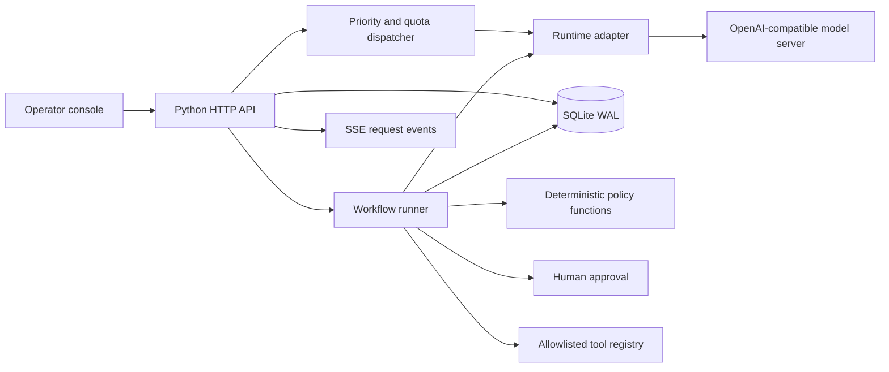

# Northstar — AI Serving Platform

A small, runnable reference implementation for model serving operations and durable agent workflows. It includes an operator console, a Python service, a streaming runtime adapter, bounded priority scheduling, request event streams, and checkpointed workflows with an approval gate.

## Developer profiles

- [GitHub](https://github.com/Shawdaimarie)
- [Handshake](https://app.joinhandshake.com/profiles/tk8y6b)
- [Codeforces](https://codeforces.com/profile/Shawdaimarie)
- [LeetCode](https://leetcode.com/u/Shawdaimarie/)
- [CodeChef](https://www.codechef.com/users/plush_rain_95)

## Run locally

Requires Python 3.10 or newer. The service uses only the Python standard library.

```bash
cd outputs/ai-serving-platform
python3 server.py
```

Open [http://127.0.0.1:8080](http://127.0.0.1:8080). The default `demo` backend emits a clearly identified deterministic response so the console can be explored without model weights. It does not run a language model and does not report token usage.

To connect a local OpenAI-compatible server such as a vLLM deployment:

```bash
MODEL_BACKEND=vllm \
MODEL_NAME=your-immutable-model-alias \
MODEL_REVISION=sha256-or-release-id \
OPENAI_BASE_URL=http://127.0.0.1:8000/v1 \
python3 server.py
```

The endpoint must support `POST /chat/completions`, streamed `data:` events, and `stream_options.include_usage` to report exact output token rates. `MODEL_NAME` is passed to that server. `MODEL_REVISION` is captured in each request and workflow snapshot; the remote backend must map the alias to an immutable model artifact. This service records the revision but cannot verify a remote artifact digest.

Set `HOST` (defaults to loopback `127.0.0.1`), `PORT`, `PLATFORM_DB`, `MAX_ACTIVE_REQUESTS`, `MAX_QUEUED_REQUESTS`, and `MAX_TENANT_ACTIVE` to adjust local settings. The SQLite database is created at `data/platform.sqlite3` by default.

## What is implemented

- **Inference lifecycle:** JSON validation, tenant and priority fields, queue and tenant limits, deadlines, cancellation, a bounded dispatcher, request snapshots, and separate control and generated-text event types.
- **Runtime seam:** a small `Runtime.generate` contract with a deterministic demo implementation and a streaming OpenAI-compatible HTTP adapter. The connected inference server owns token-level continuous batching, prompt chunking, GPU placement, precision, quantization, and KV cache policy.
- **Workflow graph:** a versioned draft → deterministic validation → refinement cycle → human approval → permission-checked save tool → terminal graph. The maximum step count prevents runaway cycles.
- **Durability:** SQLite WAL transactions checkpoint each completed workflow step and its outputs before advancing. On restart, running workflows resume at the next committed node. An idempotency key `(run_id, step_id)` protects the sample tool effect from duplicate execution.
- **Governance:** workflow inputs are typed and bounded, the graph is fixed and versioned, deterministic validation runs separately from model output, tools must be registered with a matching permission, and the sample write tool is behind approval.
- **Operator console:** deployments, model/runtime configuration, active requests, workflow runs, approvals, and health. Failures include a reason and a resume or resubmit action where available.

## API sketch

```bash
curl -s http://127.0.0.1:8080/api/health

curl -s -X POST http://127.0.0.1:8080/api/inference \
  -H 'Content-Type: application/json' \
  -d '{"prompt":"Summarize the design trade-offs.","tenant":"team-a","priority":1,"max_tokens":128}'

curl -N http://127.0.0.1:8080/api/requests/REQUEST_ID/events

curl -s -X POST http://127.0.0.1:8080/api/workflows/start \
  -H 'Content-Type: application/json' \
  -d '{"prompt":"Draft a concise release note for the new model endpoint."}'
```

Useful read routes: `/api/overview`, `/api/deployments`, `/api/models`, `/api/requests`, `/api/workflows`, `/api/workflows/{id}`, `/api/approvals`, `/api/health`, and `/api/events`. Approvals use `POST /api/approvals/{id}/approve` or `/reject`; a failed workflow can resume with `POST /api/workflows/{id}/resume`.

The dependency-free synchronous Python client in `client.py` wraps inference submission, streamed structured events, workflow runs, and approval decisions:

```python
from client import PlatformClient

client = PlatformClient()
request = client.submit_inference("Explain continuous batching in one paragraph.")
for event in client.stream_events(request["id"]):
    if event.kind == "token":
        print(event.data.get("text", ""), end="", flush=True)
    else:
        print(f"\n[{event.kind}] {event.data}")
```

## Architecture



The platform dispatcher bounds active requests, honors priority and per-tenant active quotas, and applies queue backpressure. The reference adapter sends requests to one serving API; iteration-level continuous batching and prompt/generation scheduling must be provided by that backend. The service does not claim to implement a block-level KV cache manager. GPU, KV block, fragmentation, and prefix-sharing metrics are reported as unavailable until a metrics adapter is connected.

## Scope and production follow-up

This is a single-process reference, not a production deployment. It is intended to make the contracts and operator flows concrete. Before exposing it to users, replace the local transport and storage with authenticated service boundaries, a shared transactional database and durable queue, secrets management, audit retention, and health/metrics adapters. Add adapter-specific cancellation that can interrupt backend work. Use an immutable model registry to resolve and verify revisions. For a first production inference runtime, configure a serving engine with continuous batching and its own prompt chunking and KV block manager; attach its measured Prometheus or native telemetry.

Current measured values are local queue depth, active slots, queue time, workflow status, and backend-reported output token throughput when `include_usage` is supported. The console does not fabricate GPU utilization, accelerator memory, KV allocation, fragmentation, or historical time-series data. The HTTP service has no authentication and should remain bound to a trusted local environment until an authenticated gateway and authorization checks are added.
